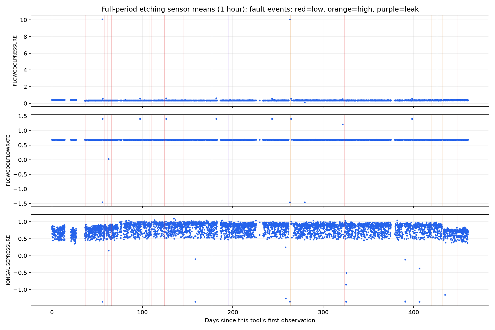
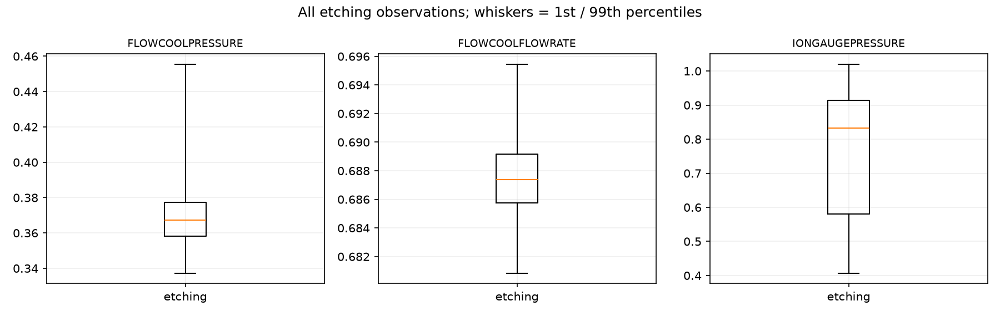
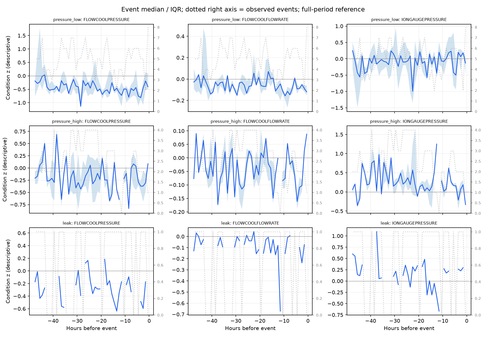

# 01M01 장비별 전체 기간 EDA

- 원본 **3,124,704행**, 기간 **460.1일**. 무작위 샘플링 없음.
- 완전 중복 **878행** 제거 후 **3,123,826행**. 센서·TTF 시각 일치 확인.
- 식각 중(셔터 1) **1,486,846행 (47.6%)**. 전체 상태 품질 검사는 별도 수행.
- 동일 시각의 서로 다른 기록 **4,310개 시각**은 보존. 행 가중 분석이므로 중복 시각 영향 가능.
- 60초 초과 관측 공백 **11,963개**. 공백은 보간하지 않음.
- 고장 기록 **19건 → 중복 제외 19건 → 24시간 묶음 16사건**.
- 고장 전 24시간의 관측 분 점유율 중앙값 **40.2%** (전체 운전 상태; 1분에 관측 1개 이상).

| 고장 종류 | 사건 수 |
|---|---:|
| pressure_low | 10 |
| pressure_high | 5 |
| leak | 1 |

## 결과 그림







## 해석 기준

- 전체 기간 그림은 모든 식각 관측을 1시간 평균으로 요약. 빈 시간은 채우지 않음.
- 스텝은 레시피·가동 번호·단계·웨이퍼·셔터 변경과 60초 초과 공백에서 분리.
- 고장 궤적은 사건별 시간당 평균의 중앙값과 사분위 범위. 오른쪽 점선은 실제 관측 사건 수.
- z값은 **전체 기간 식각 관측의 레시피×스텝 평균·표준편차** 기준. 정상 확정 기준이 아니며 미래 정보가 포함된 설명용 통계.
- 같은 장비·종류의 앞 기록과 간격이 24시간 이하면 같은 사건으로 연결. 실제 정비 사건의 정답은 아님.
- TTF 결측을 정상으로 채우지 않음. 예측 성능·사전 경고 시간은 이 EDA로 판단하지 않음.
- 고장 시각은 정비 정지 시각이며 실제 이상 시작 시각은 알 수 없음. 반복 사건도 독립 표본으로 볼 수 없음.
- 시간 단위는 초로 가정. 식각 비율은 **행 비율**이며 공백을 포함하는 달력 가동률이 아님.

## 재실행

```bash
python -m src.eda.run --tool 01M01
python -m src.eda.run --tool 01M01 --force
```

입력 파일 크기·수정시각, 설정, 실행 코드 해시가 같고 산출물이 있으면 재사용.
전체 스텝 데이터: `data/interim/eda/01M01/steps_0d85a408734a.parquet` (git 제외).
